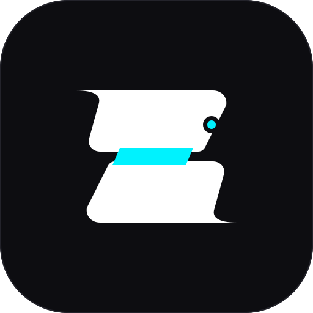

# CapBD: Cross-Platform Photo & Video Editor

<p align="center">
  
</p>

<p align="center">
  <strong>High-Performance, Cross-Platform Photo & Video Editor Written 100% in Rust</strong><br>
  <em>Inspired by CapCut — Designed for Creators on Desktop & Mobile.</em>
</p>

<p align="center">
  <a href="https://github.com/capbd/capbd/actions"></a>
  <a href="LICENSE"></a>
  
  
</p>

---

## Overview

**CapBD** is a modern non-linear video and photo editing application built with a 100% Rust architecture. Designed as a professional open-source alternative to CapCut, CapBD features a sleek dark-mode aesthetic, an interactive multi-track magnetic timeline, live GPU-accelerated video rendering with WGSL shaders, real-time color grading, and multi-format export capabilities.

### Key Highlights
- **100% Pure Rust**: Zero web runtime or Electron bloat. Near-instant startup and minimal memory footprint.
- **Hardware-Accelerated Viewport**: Real-time video canvas powered by `wgpu` (Direct3D 12 on Windows, Metal on macOS, Vulkan on Linux & Android).
- **Multi-Track Magnetic Timeline**: Seamless video, audio, text, and effects tracks with automatic magnetic snapping, razor blade splitting (`Ctrl+B`), and edge trimming.
- **CapCut-Grade Color Grading**: Real-time sliders for Exposure, Brightness, Contrast, Saturation, Temperature (warm/cool), Tint, and Vignette.
- **Clean Vector Iconography**: 100% custom mathematical vector icons designed for high-DPI displays — strictly zero emojis.
- **Universal Aspect Ratios**: Instant toggle between `16:9` (YouTube/Desktop), `9:16` (TikTok/Reels/Shorts), `1:1` (Instagram), `4:5` (Social Portrait), and `21:9` (Cinematic).

---

## CapBD vs CapCut Feature Matrix

| Feature | CapCut | CapBD (Rust) |
| :--- | :---: | :---: |
| **Technology** | C++ / Proprietary UI | **100% Rust (`egui` + `wgpu`)** |
| **Platform Support** | Windows, Mac, Android, iOS | **Windows, Linux, macOS, Android** |
| **Open Source** | Closed Source | **Open Source (MIT / Apache-2.0)** |
| **Magnetic Multi-Track Timeline** | Yes | **Yes** |
| **Precision Split Tool (`Ctrl+B`)** | Yes | **Yes** |
| **In/Out Point Edge Trimming** | Yes | **Yes** |
| **Aspect Ratios (`16:9`, `9:16`, `1:1`)** | Yes | **Yes** |
| **GPU Color Grading & Filters** | Yes | **Yes (WGSL Shaders)** |
| **Position / Scale / Rotation / Opacity** | Yes | **Yes** |
| **Undo / Redo History Stack** | Yes | **Yes** |
| **Export Resolutions** | 720p / 1080p / 4K | **720p / 1080p / 4K** |

---

## Workspace Architecture

```
capbd/
├── crates/
│   ├── capbd-core/       # Timeline models, Tracks, Clips, Timecodes, Undo/Redo, Project JSON
│   ├── capbd-engine/     # wgpu GPU shaders, procedural video generators, audio mixer, exporter
│   ├── capbd-ui/         # CapCut dark theme, vector icons, magnetic timeline, viewport, inspector
│   ├── capbd-desktop/    # Native executable runner for Windows, Linux, macOS
│   └── capbd-android/    # Android NDK native activity wrapper
├── assets/
│   └── logo/             # Master SVG and raster app branding assets
└── .github/
    └── workflows/        # Multi-platform CI/CD and release automation
```

---

## Step-by-Step Build & Installation Guide

### 1. Prerequisites
Install Rust and Cargo using [rustup.rs](https://rustup.rs/):
```bash
curl --proto '=https' --tlsv1.2 -sSf https://sh.rustup.rs | sh
```

### 2. Windows (x86_64)
```powershell
# Clone the repository
git clone https://github.com/capbd/capbd.git
cd capbd

# Build and run the desktop editor
cargo run --release -p capbd-desktop
```

### 3. Linux (Ubuntu / Debian / Fedora / Arch)
Install system multimedia & graphics packages:
```bash
# Ubuntu / Debian
sudo apt-get update
sudo apt-get install libasound2-dev libudev-dev libwayland-dev libxkbcommon-dev libvulkan-dev pkg-config

# Fedora
sudo dnf install alsa-lib-devel systemd-devel libxkbcommon-devel vulkan-loader-devel

# Run CapBD
cargo run --release -p capbd-desktop
```

### 4. macOS (Apple Silicon M1/M2/M3 & Intel)
```bash
cargo run --release -p capbd-desktop
```

### 5. Android Build
Build using `cargo-apk`:
```bash
# Install Android target and cargo-apk
rustup target add aarch64-linux-android
cargo install cargo-apk

# Build APK
cargo apk build --package capbd-android
```

---

## Keyboard Shortcuts

| Shortcut | Action |
| :--- | :--- |
| `Space` | Play / Pause video playback |
| `Ctrl + B` | Split active clip at playhead (Razor Blade) |
| `Delete` / `Backspace` | Delete selected clip from timeline |
| `Ctrl + Z` | Undo last action |
| `Ctrl + Y` / `Ctrl + Shift + Z` | Redo action |
| `Left Arrow` / `Right Arrow` | Step 1 frame backward / forward |
| `Home` / `End` | Jump to beginning / end of timeline |

---

## License

This project is licensed under either of:
- **MIT License** ([LICENSE-MIT](LICENSE) or http://opensource.org/licenses/MIT)
- **Apache License, Version 2.0** (http://www.apache.org/licenses/LICENSE-2.0)

at your option.
